<h3 align="center"><samp>Hi, I'm Satvik 🧾</samp></h3>

<samp>
ML/NLP researcher at ASU and part-time hallucination auditor. 
I build AI that cites its sources, explains its grades, 
and says "I don't know" when it doesn't.
</samp>

  

<samp>
<b>[1]</b> <a href="https://arxiv.org/abs/2411.03284">SMoA, PAKDD '25</a> &nbsp;
<b>[2]</b> <a href="https://arxiv.org/abs/2504.00389">CyberBOT, CIKM '25</a> &nbsp;
<b>[3]</b> <a href="https://arxiv.org/abs/2512.20817">EssayCBM, ECML-PKDD '26</a> 
<b>[4]</b> <a href="https://ssrn.com/abstract=7622718">Trustworthy Education in the Era of GenAI, SSRN '26</a> &nbsp;
<b>[5]</b> <a href="https://arxiv.org/abs/2605.27402">REC-CBM, SDM '26</a> 
<b>[6]</b> transcript available on request &nbsp;
<b>[7]</b> <a href="https://github.com/ks-satvik/footnote">footnote</a> &nbsp;
<b>[8]</b> <a href="https://github.com/ks-satvik/tally-sql-agent">tally</a> &nbsp;
<b>[9]</b> voot (private, demo on request)
</samp>

 

<samp>
<a href="https://scholar.google.com/citations?user=cb0Qe1sAAAAJ">scholar</a> ·
<a href="https://linkedin.com/in/kshchaudhary04">linkedin</a> ·
<a href="mailto:kchaud13@asu.edu">email</a>
</samp>

<samp>receipts for everything are in the repos below ⬇️</samp>

